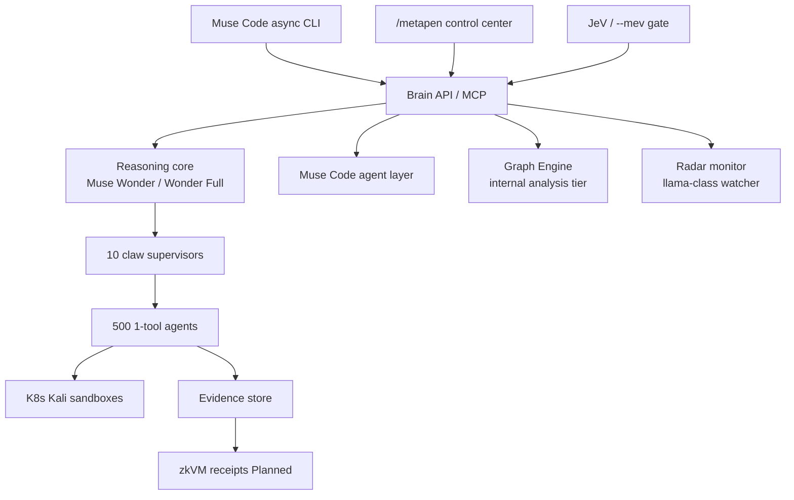
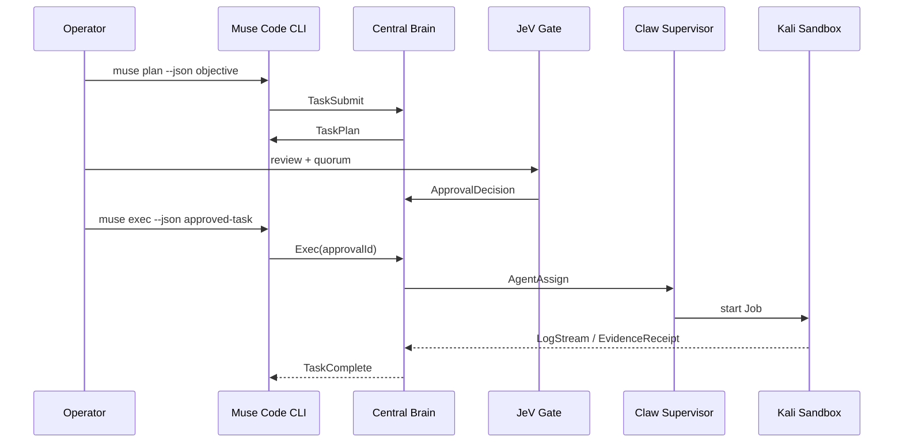

# MetaPen Project Blueprint

**Status:** Architecture / design doc for iteration  
**Grounded in:** `/workspace/Jules-Claw` — Open Web LLM v0.6.0, branch `metapen-increment-1`  
**Honesty rule:** Counts like “500 agents / 32 active” and zkVM “verified” tags are **concept / target** unless a live worker or receipt verifier exists. Never present concept UI as telemetry.

---

## 1. Vision & scope

MetaPen is a **self-hostable AI cybersecurity / pentesting OS**: one control plane that coordinates perception, reasoning, reporting, and bounded action against **owned-lab** targets only.

| | |
|---|---|
| **Tagline** | “500 agents. One mission.” (fleet **target**, not live pool today) |
| **Default posture** | Lab-only, evidence-first, approval-bound |
| **Pipeline** | Perception → Reasoning → **Report** → Action |
| **Product identity today** | Open Web LLM control plane (Jules-Claw repo); MetaPen is the cybersecurity OS shell folding that plane into Claw Swarm + JeV gates |
| **Not claimed** | Official Meta product; live 500-agent fleet; live zkVM proofs; unrestricted exploitation |

**Non-negotiables**

1. `scope.yaml` (or equivalent auth file) is law before any mutating / exploit-class work.
2. Read-only recon by default; exploitation requires explicit, short-lived, audited approval.
3. Findings without evidence receipts stay labeled advisory / unproven.
4. Concept UI (dragon core, 10×50 claw grids) must stay labeled **concept** until real workers feed them.

---

## 2. Current state (implemented today)

Branch `metapen-increment-1` builds on Open Web LLM **v0.6.0**. What exists in code:

### Control plane

| Piece | Location | Reality |
|---|---|---|
| Next.js 16.4 / React 19 app | `app/` | Loopback-oriented local operator UI |
| HTTP Basic auth + host gate | `proxy.js`, `lib/access-mode.mjs` | Single-operator; fail-closed if password unset / host not permitted |
| Fail-closed Origin for mutations | `lib/same-origin.mjs`, `proxy.js` | Missing or mismatched `Origin` → 403 on mutating `/api/*` |
| Node ≥24 pin | `package.json` `engines`, `.nvmrc`, README | Required for `node:sqlite` approval store |

### Live APIs / backends

| Capability | Files | What it actually does |
|---|---|---|
| **6-role advisory swarm** | `lib/swarm.js`, `app/api/swarm/route.js` | Real OpenAI-compatible gateway calls when `SWARM_ENABLED` + six `SWARM_MODEL_*` set; **no** code exec / file write |
| Swarm status GET | `swarmStatus()` in `lib/swarm.js` | Reports configured role count (0–6), not 500 |
| **JeV / --mev approvals** | `lib/capability-approvals.mjs`, `app/api/capabilities/route.js`, `scripts/approve-capability.mjs` | Allowlisted `verify.syntax` / `verify.node-tests`; request via API; **decide/consume only via local TTY** |
| Desk journal | `lib/desk.js`, `app/api/desk`, `migrations/0001_desk.sql` | User-authored notes; not auto-verified findings |
| Verification jobs | `lib/verification.js`, `app/api/verification`, `worker/` | PostgreSQL queue + Docker worker; profiles **`syntax`** and **`node-tests` only** |
| Jules sessions | `lib/jules.js`, `app/api/sessions/**` | Upstream coding-provider sessions; params awaited (Next 16) |

### MetaPen UI (Increment 1)

| Surface | Files |
|---|---|
| Route `/metapen` | `app/metapen/page.js` |
| Kali Dragon + claw orbit | `components/DragonCore.js`, `SwarmControlCenter.js`, `ClawCard.js`, `DotGrid.js` |
| Mission / coverage / swarm map | `LeftSidebar.js` + `lib/claws.mjs` (`SWARM_CONCEPT`) |
| JeV gatekeeper sidebar | `RightSidebar.js` (wired to `/api/capabilities`; remote Approve/Reject intentionally disabled) |
| Muse CLI strip | `MuseCliStrip.js` (display + status lines; **no** remote shell) |
| Claw catalog | `lib/claws.mjs` — 10 domains × 50 slots; ~390 named tools + unassigned padding |

**Tests (Node 24):** 65/65 green as of blueprint commit (includes `tests/same-origin.test.mjs`, `tests/claws.test.mjs`).

**Explicitly not live today:** 500 sandboxes, Kali-per-agent pods, zkVM receipts, remote quorum approve, radar llama monitor, Muse↔Brain JSON-RPC bus.

---

## 3. Target architecture

### 3.1 One agent · one tool · 500 slots

```
10 claws × 50 agents = 500 agents
each agent ↔ exactly ONE dedicated tool = 500 tool bindings
```

| Claw | Domain | Concept ACTIVE (UI) | Role of mastery |
|---|---|---|---|
| CLAW 01 | RECON | 4/50 | Surface discovery (nmap, amass, httpx, …) |
| CLAW 02 | WEB | 5/50 | App / browser-class testing (zap, sqlmap, …) |
| CLAW 03 | API | 3/50 | API route & schema abuse (arjun, kiterunner, …) |
| CLAW 04 | IDENTITY | 4/50 | Auth / AD lab paths (bloodhound, impacket, …) |
| CLAW 05 | SOURCE | 4/50 | Static / binary / smart-contract analysis |
| CLAW 06 | DEPENDENCIES | 3/50 | SBOM / vuln matching (trivy, grype, osv-scanner, …) |
| CLAW 07 | CONFIG | 3/50 | Secrets & IaC misconfig (detect-secrets, tfsec, …) |
| CLAW 08 | CLOUD | 3/50 | Cloud / k8s posture (prowler, kube-bench, …) |
| CLAW 09 | DEFENSE | 3/50 | Blue-team / forensics (suricata, falco, yara, …) |
| CLAW 10 | EVIDENCE | 3/50 | Proof generation & packaging (foundry, mythril, …) |

**Mastery model**

1. Agent identity = `{clawId, slot, toolId}` — immutable for a release.
2. Prompt / skill pack is tool-specific (flags, safe defaults, output schema).
3. Agent may **only** invoke its bound tool binary (or MCP wrapper) inside its sandbox.
4. Cross-tool composition happens at **supervisor / brain** layer, never by elevating one agent to a shell.

Catalog source of truth for naming: `lib/claws.mjs` (expand unassigned slots as real adapters land).

### 3.2 500 Kubernetes sandboxes (Kali-derived)

**Target:** one Pod (or Job) per agent, image = customized Kali (or minimal distro + tool) with that agent’s tool preinstalled.

| Concern | Design |
|---|---|
| **Isolation** | Dedicated ServiceAccount; no hostPath; read-only rootfs + emptyDir work; dropped caps; `seccompProfile: RuntimeDefault`; optional gVisor/Kata later |
| **Network** | Default-deny NetworkPolicy; egress only to explicitly scoped CIDRs / DNS from `scope.yaml`; no pod-to-pod except to Brain ingress |
| **Resources** | Per-claw `requests/limits` (CPU/mem); tool-class profiles (recon light vs hashcat heavy) |
| **Lifecycle** | Ephemeral Jobs: create on approved task → stream logs → upload evidence → delete; idle agents stay as warm pool **or** scale-to-zero (cost tradeoff) |
| **Scheduling** | Brain emits `SandboxLease` after JeV approve; kube scheduler + custom controller bind lease → pod; TTL = approval expiry |
| **Image build** | Multi-stage: base Kali slim → layer per claw → final image per tool (or claw-shared image + tool binary mount from signed OCI artifact) |

**Feasible MVP:** 1–3 tools/claw as Jobs on a single cluster, not 500 warm pods on day one.

### 3.3 Central Brain orchestration



| Layer | Model / role | Notes |
|---|---|---|
| Planning & correlation | **Muse Wonder** (Wonder Full via Muse Code where applicable) | Long-context multi-agent synthesis |
| Terminal / coding harness | **Muse Code** | Async CLI, adapters, MCP wrappers |
| Graph / analysis | **Graph Engine** | Internal name — **not** “Libra” |
| Fleet watch | Radar (llama-class) | Health, drift, runaway cost, scope violations |
| Supervisors | 10 orchestrator bots | One per claw; queue, retry, escalate to JeV |

### 3.4 zkVM layer (Planned — no live proof claimed)

**Goal:** selected computations emit a **cryptographic receipt** bound to inputs/outputs for immutable audit.

**Proposed receipt schema (design only)**

```json
{
  "receiptVersion": "metapen-zk-1",
  "attestationKind": "hash-receipt",
  "taskId": "uuid",
  "approvalId": "uuid",
  "scopeDigest": "sha256:…",
  "inputDigest": "sha256:…",
  "outputDigest": "sha256:…",
  "toolId": "nmap",
  "sandboxImageDigest": "sha256:…",
  "prover": "planned-zkvm",
  "proof": null,
  "status": "planned"
}
```

**Verification flow (target):** worker finishes → hash IO → (optional) prove in zkVM → store receipt beside evidence → UI shows “Planned” until prover exists; never display “VERIFIED” without a verifying verifier.

---

## 4. CLI ↔ Central Brain protocol

### 4.1 Transport (recommended)

| Phase | Transport | Why |
|---|---|---|
| Near-term | **HTTPS REST** + **SSE/WebSocket** log stream | Fits existing Next `/api/*` |
| Agent tooling | **MCP server** wrapping the same ops | Muse Code / IDE agents |
| Optional later | JSON-RPC 2.0 over WS | Multiplexed telemetry |

Auth: replace shared Basic with session/OIDC (roadmap); until then local Basic + fail-closed Origin for browser mutations. CLI uses bearer / mTLS to Brain.

### 4.2 Core message types

| Type | Direction | Purpose |
|---|---|---|
| `TaskSubmit` | CLI → Brain | Scoped objective + risk hint |
| `TaskPlan` | Brain → CLI | Supervisor plan (tools, claws, estimates) |
| `ApprovalRequest` | Brain → JeV | Capability + digests |
| `ApprovalDecision` | JeV → Brain | approve/reject + quorum ids |
| `AgentAssign` | Brain → Supervisor | Bind approved subtasks to 1-tool agents |
| `AgentTelemetry` | Agent → Brain | heartbeat, stage, cost |
| `LogStream` | Agent → CLI/UI | stdout/stderr chunks |
| `EvidenceReceipt` | Agent → Brain | artifacts + digests |
| `ZkReceipt` | Prover → Brain | Planned |
| `TaskComplete` | Brain → CLI | terminal status |

### 4.3 `muse exec --json <approved task>` end-to-end

1. Operator obtains `approvalId` (TTY today; JeV UI later with real decide API).
2. CLI sends `POST /api/brain/exec` with `{ approvalId, taskEnvelope }` — **new**.
3. Brain verifies approval state, expiry, action digest, scope digest.
4. Supervisors schedule sandboxes; stream `LogStream`.
5. Evidence + (planned) zk receipt persisted; CLI prints JSON summary.

**Example request**

```json
{
  "approvalId": "7c9e6679-7425-40de-944b-e07fc1f90ae7",
  "confirmCost": true,
  "task": {
    "objective": "Enumerate HTTP services on 10.0.0.0/24",
    "scopeDigest": "sha256:…",
    "risk": "Safe",
    "preferredClaws": ["claw-01"]
  }
}
```

**Example response**

```json
{
  "execId": "…",
  "status": "queued",
  "assigned": [{ "agentId": "claw-01-slot-03", "toolId": "nmap" }],
  "notice": "Execution bound to approval digest; sandbox network restricted to scope."
}
```

### 4.4 Existing vs new endpoints

| Endpoint | Today | Needed |
|---|---|---|
| `GET/POST /api/swarm` | Live advisory 6-role | Keep; do not pretend it is 500 |
| `GET/POST /api/capabilities` | Request + list; no remote decide | Add decide only behind strong auth **or** keep TTY |
| `GET/POST /api/sessions*` | Jules sessions | Unchanged |
| `GET/POST /api/verification*` | Docker profiles | Keep as evidence path |
| `GET /api/desk` | Journal | Keep |
| `POST /api/brain/plan` | — | **New** TaskPlan |
| `POST /api/brain/exec` | — | **New** approved exec |
| `GET /api/brain/exec/:id/events` | — | **New** SSE/WS |
| `GET /api/claws` | UI embeds `lib/claws.mjs` | **New** optional catalog API |
| `POST /api/evidence/bundles` | partial via verification/desk | **New** normalized bundles |

---

## 5. JeV / --mev approval gate

Human-in-the-loop gatekeeper. UI label: `--mev / JeV Gatekeeper`.

| Control | Design |
|---|---|
| Risk posture | Safe / Medium / Critical — gates which claws/tools may be proposed |
| Quorum | Two reviewers for Medium+ (Critical always); Safe may be single-op in lab mode |
| Scope | `scope.yaml` required; owned-lab CIDRs / host allowlist; network restricted |
| Default | Read-only recon; no exploit-class tools without Critical + explicit capability |
| Expiry | Short TTL (~5–10 min pending; consume-once) — matches current approval store spirit |
| Audit | Append-only execution events (already sketched in `capability-approvals.mjs`) + session replay hooks |
| Disclosure | Templates for responsible disclosure packaged with Evidence claw |

**Today:** request via API; decide/consume via `npm run approval` / `execute:approved`. Remote Approve/Reject buttons in UI are disabled on purpose.

---

## 6. Interface design & output formats

### 6.1 Control center surfaces (live UI)

| Tab | Purpose |
|---|---|
| Overview | Live counts from APIs + concept fleet size |
| Claw Swarm | Dragon core, 10 claws, sidebars, Muse strip |
| JeV Desk | Approvals CRUD-ish + TTY reminder |
| Evidence | Verification jobs, desk notes, Planned zkVM |
| Models | Muse Code / Muse Wonder / Graph Engine naming |

### 6.2 Machine-readable outputs (target schemas)

**Finding JSON (sketch)**

```json
{
  "findingId": "…",
  "severity": "high",
  "title": "…",
  "asset": { "host": "…", "service": "…" },
  "evidenceDigests": ["sha256:…"],
  "toolId": "nuclei",
  "agentId": "claw-02-slot-12",
  "approvalId": "…",
  "remediation": "…"
}
```

**Evidence bundle:** tar/zip with `manifest.json`, raw tool stdout, screenshots optional, SARIF, finding JSON, approval digests.

**SARIF:** export vulns for IDE/CI (`runs[].tool.driver.name` = toolId).

**Client report:** Markdown → PDF; sections Perception / Reasoning / Report / Action; no unverified “exploited” language.

**zkVM receipt:** see §3.4; status `planned` until prover ships.

---

## 7. UI/UX flows & personas

### Personas

| Persona | Goals | Primary surfaces |
|---|---|---|
| Solo researcher / lab learner | Safe HTB/VulnHub practice | Overview, Claw Swarm, Evidence |
| Pentest team lead / reviewer | Quorum, scope, client report | JeV Desk, Evidence, report export |
| Blue-team / defense analyst | Detect, hunt, harden | DEFENSE claw, Evidence, SARIF |
| Platform operator | Auth, cluster, cost, uptime | Models, swarm status, K8s ops (future) |

### End-to-end journey

1. **Define scope** — author `scope.yaml`; import to Brain; UI shows Mission Scope.
2. **Launch swarm (plan)** — Muse CLI or UI submits objective → TaskPlan from Wonder.
3. **Review plan** — lead adjusts claws/tools; risk posture set.
4. **Approve** — JeV quorum / TTY; short TTL.
5. **Execute** — `muse exec --json` → sandboxes → telemetry.
6. **Review findings** — Evidence tab; reject false positives.
7. **Export** — SARIF + Markdown/PDF report + evidence bundle.
8. **Disclose / remediate** — templates; no silent exploit claims.

---

## 8. Improvements / hardening roadmap

### Audit fold-in (from prior Jules-Claw / MetaPen audit)

| Finding | Disposition |
|---|---|
| Shared Basic credential | Phase 2: real accounts / OIDC; keep fail-closed local mode |
| Durable multi-tenant state | Expand PG + RLS; don’t pretend memory is multi-user |
| Rate limits | Gateway + Brain quotas (`lib/quotas.js` patterns) |
| Audit logs | Extend approval execution chain; ship export |
| Node 20 / sqlite | **Done** — engines ≥24 |
| Un-awaited params | **Done** |
| Optional Origin | **Done** — fail-closed |

### Phased delivery

| Phase | Scope | Feasibility |
|---|---|---|
| **1 — Done (Increment 1)** | MetaPen shell, claw catalog, JeV UI wiring, Origin/Node pins, honest labels | Shipped on `metapen-increment-1` |
| **2 — Sandbox MVP** | K8s Jobs for ≤3 tools/claw; real approve→exec path; scope.yaml enforcement; account auth | Feasible with focused eng |
| **3 — Scale + receipts** | Warm/cold pool toward 500; zkVM hash receipts; self-host Helm chart; MCP Brain | Partially aspirational; zkVM + full 500 warm is high cost/risk |

### Feasible vs aspirational

| Feasible near-term | Aspirational |
|---|---|
| Few real Kali Jobs + approval-bound exec | 500 always-on sandboxes |
| Muse Code CLI talking REST/SSE to Brain | Full MCP + multi-cluster federation |
| Hash-chained evidence digests | Production zkVM prover for every tool run |
| Two-reviewer UI backed by real decide API | Fully autonomous Critical exploit loops |

### Biggest technical risks

1. **Blast radius** if NetworkPolicy / scope binding fails.
2. **Cost** of 500 concurrent Kali-class pods.
3. **Tool licensing / legality** — keep lab-only; never market as attack-as-a-service.
4. **False “verified” UX** — zkVM and ACTIVE counts must stay honest.
5. **Approval bypass** if remote decide ships without strong auth + digest binding.

---

## Appendix A — Key repo paths

```
app/metapen/page.js
app/metapen/components/*
lib/claws.mjs
lib/swarm.js
lib/capability-approvals.mjs
lib/same-origin.mjs
proxy.js
worker/
docs/METAPEN_BLUEPRINT.md  (this file)
```

## Appendix B — CLI ↔ Brain sequence (mermaid)



---

*Document generated for local iteration on branch `metapen-increment-1`. Not an official Meta release.*
