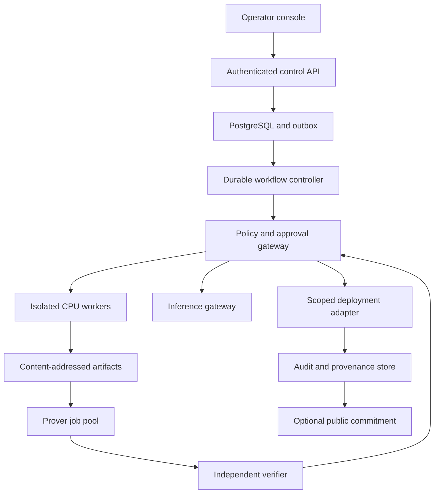
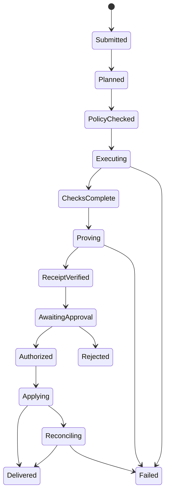

# Nirvana master blueprint

Version 1.0 · 27 October 2026 · proposed architecture

## 1. Product and scope

Nirvana is a governed task execution platform: a user submits a bounded objective; a workflow plans actions; a policy gateway restricts tools; people approve high-impact changes; workers execute in isolation; an evidence service records exactly what ran. A RISC Zero guest proves selected deterministic checks over committed artifacts. The first usable product is one vertical slice of code-change review, not four independent unfinished products.

**Initial outcome:** request a small repository change, produce a patch in an isolated worker, run tests, evaluate a deterministic release manifest, verify its real receipt, collect human approval bound to that manifest, and publish to a non-production staging target. The console displays actual state and downloadable evidence.

**Second outcome:** task-scoped private memory with authenticated retrieval grants. **Third outcome:** simulation-based policy checking. Physical actuation is a separate, hardware-qualified release gate.

Keep the proposed tagline as positioning only until evidence supports it: “Build with NVIDIA. Verify with RISC Zero. Own on Nebius.” Own means control of project data and deployment, not an unsupported legal or physical-isolation guarantee.

## 2. Correct the original assumptions

| Proposal | Engineering decision |
|---|---|
| Hardcode `nvidia/nemotron-3-ultra`, Super and Nano | Discover account-visible catalog IDs. Map logical planner/coder/router roles to tested exact IDs. Abort when configured IDs disappear. No silent external provider fallback. |
| All interactive responses below 500 ms | Set measured stage-specific SLOs. Separate time-to-first-token, total generation time, queue delay and UI acknowledgement. No universal latency promise. |
| Everything inside a private VPC via serverless endpoints | Treat managed public inference and private dedicated inference as different modes. Prove private routing and logging behavior before privacy claims. |
| Every line of generated code proven correct | Prove a named guest's execution and explicit predicates over committed data. Tests, trusted input acquisition and specification quality remain separate assumptions. |
| A constant 20-minute proving time | Benchmark guest cycles, proof mode and hardware; report distributions and queue time. |
| 90% cheap model / 10% large model | A hypothesis to evaluate on representative tasks; routing never bypasses authorization. |
| Deploy arbitrary generated code to Token Factory | Token Factory serves model inference. Deploy applications to a qualified compute/container target; use Token Factory for supported model serving. |
| All agent workers on H100/A100 Kata GPU microVMs | CPU Kata workers execute untrusted code first. Put inference and proving on separate qualified pools. GPU passthrough requires actual host, virtualization and driver compatibility tests. |
| MCP exposed as generic gRPC | Use a standards-compatible MCP client/server transport, schema negotiation and pinned tool registry. Internal worker RPC may use gRPC separately. |
| nmap, Burp and Docker available to every agent | Default-deny capability inventory. Network/security testing only against explicitly approved owned targets. No host Docker socket. |
| PII redaction guarantees zero leakage | Redaction is defense in depth with false negatives. Minimize collection, enforce grants and private inference boundaries, and test leakage. |
| Post all receipts publicly through Blobstream | Default to private receipts. Publish minimal consented commitments using current Celestia APIs. Blobstream is not required for native blob submission and current docs mark it legacy. |
| Robot proof before every high-risk maneuver | Verify a pre-action bounded policy/certificate; independent local safety controller enforces torque/velocity and emergency stop. A proof cannot attest future sensor truth or future safe behavior. |

## 3. Target system topology



Deploy control services, database, object storage, workers and observability in a chosen Nebius project/region when available and qualified. The Sites prototype is a distinct bootstrap artifact. A strict sovereignty release moves the web UI and API onto the qualified deployment too; DNS/CDN, analytics, fonts, traces, support access, backups and key custody are included in the data-flow inventory.

Use Kubernetes if its operational burden is justified by Kata worker lifecycle and GPU scheduling. Start with a small managed cluster or explicitly configured VMs; pick supported products after account capability discovery. “Serverless Jobs” is an interface requirement, not a claim that an identically named Nebius service exists in the account. A Kubernetes Job adapter can satisfy it. No provision command executes from this document.

### Planes and responsibilities

- **Control plane:** API, identity validation, workspace tenancy, task records, DAG orchestration, approval records, billing limits, event projections. No untrusted user code.
- **Execution plane:** disposable CPU worker microVMs; constrained tool gateway; job leases and heartbeats; artifacts only through scoped upload/download channels.
- **Inference plane:** centralized provider adapter with exact model IDs, deadlines, token budgets, privacy mode and circuit breaker. Model output is untrusted data.
- **Evidence plane:** artifact digests, versioned check manifests, prover and separate verifier, append-only audit, signed evidence envelopes and optional public commitment.
- **Memory plane:** encrypted records, embeddings, grants and tenant partitioning. Retrieval grants verified before query and before response assembly.
- **Physical plane:** simulator adapter, policy registry and device gateway. No direct model-to-actuator path.

## 4. Recommended source organization

```text
apps/console/                responsive web application
services/control-api/        identity, task and approval APIs
services/orchestrator/       durable state machine and outbox consumers
services/inference-gateway/  catalog discovery and bounded generation
services/tool-gateway/       MCP registry and policy enforcement
services/worker-agent/       lease, sandbox and artifact capture
services/evidence/           proof jobs, independent verification, exports
services/memory/             grants, retention and retrieval
services/edge-gateway/       simulation and signed deployment manifests
packages/contracts/         generated schemas and typed clients
packages/policy/            deterministic authorization rules
packages/audit/             canonical serialization and event signing
zkvm/guest/                 bounded deterministic manifest checks
zkvm/host/                  proving and verification entrypoints
infra/                     reviewed IaC and region overlays
migrations/                versioned PostgreSQL migrations
integration-tests/         real database and worker tests
qualification/             live gate scripts and retained evidence
```

Suggested implementation: TypeScript web console, Python control/orchestration services, Rust zkVM guest/host; PostgreSQL as system of record and S3-compatible object storage for large artifacts where supported. Pin supported versions during bootstrap; publish lockfiles and a software bill of materials. Do not introduce five orchestration frameworks. A transactional outbox with leased consumers is sufficient for the first vertical slice; adopt a durable workflow product only if it simplifies retries and recovery without creating an unqualified external dependency.

## 5. Domain records and storage

Every record includes `workspace_id`, immutable ID, creation time and schema version where applicable. Use tenant-scoped foreign keys, unique constraints and access checks; do not rely only on client-provided IDs.

| Table / object | Required fields and invariants |
|---|---|
| workspace / membership | OIDC subject, role, status; only server-controlled membership grants access |
| task | objective, scope, version, state, budget, input digest, policy version; immutable revisions |
| workflow_step | task revision, dependencies, attempt, state, idempotency key; no cycles |
| execution | sandbox image digest, lease owner, deadline, code digest, network policy, exit status |
| approval | actor, action digest, task revision, expiry, nonce, decision; append-only |
| capability_grant | subject, allowed tool and resource, action digest, expiry; one-use when applicable |
| artifact | digest, size, media type, object version, retention class; immutable bytes |
| proof_job / receipt | guest image ID, journal digest, seal artifact, mode, verifier version, verification result |
| memory / memory_grant | encrypted content reference, workspace, source, purpose, expiry, task and subject binding |
| audit_event | workspace sequence, previous digest, canonical event digest, signing-key ID |
| outbox / job_lease | event ID, available time, attempts, lease token, heartbeat, last error |
| device / policy_release | device identity, policy hash, safety envelope, validity window, acknowledged version |

Artifacts use SHA-256 over exact bytes; logical JSON uses a documented canonical encoding before hashing. Define protocol versions and domain-separated hash prefixes. Store approval keys and runtime credentials separately from application tables. Envelope-encrypt private memory and sensitive artifacts with workspace-scoped data keys under controlled key management. Rotation and deletion must include embeddings, logs and backups according to retention policy.

## 6. Workflow state machine and irreversible boundary



Read-only workflows may terminate after checks without proof if policy explicitly permits and UI labels the result unproven. Production deployment requires all configured checks, verified receipt, and explicit action-bound approval. Sandbox execution is distinct from external application. An approval received earlier is invalid after any artifact, destination, budget or policy change.

Every transition is a transaction with optimistic version check plus outbox event. Consumers use leases and idempotency; no “exactly once” claim for external services. Before retrying an uncertain deployment, query target state using the action ID and reconcile. A crash after an external action but before acknowledgement must not duplicate the action.

Cancellation is a durable request, followed by sandbox termination and confirmed exit. Cancellation during an irreversible external call enters reconciliation; it cannot promise rollback. Job expiry, revocation and exhausted budget fail closed. Retry transient errors with bounded backoff; do not retry denied policies or invalid proofs.

## 7. Policy, approval and JEV

JEV is the human checkpoint and policy interface. A probabilistic risk score may recommend escalation; deterministic policy controls whether execution is allowed. Models cannot manufacture capability grants or approve their own actions.

Tier 0: bounded read-only retrieval over permitted data. Tier 1: isolated patch/test creation with no external writes. Tier 2: reversible staging changes with scoped human approval. Tier 3: production, sensitive data export, financial or physical actions; dedicated policy and approval, with physical release held until qualified.

Construct an action manifest containing workspace, task revision, artifact digest, exact tool/method, destination/resource, argument digest, policy version, maximum spend, expiry and nonce. The approval digest covers this complete manifest. At the tool boundary, check actor role, grant validity, unchanged manifest, current policy, required evidence and unused nonce inside a transaction. Reserve/consume authorization consistently with action idempotency. Revoked membership overrides an old approval.

Threats: prompt injection in repositories or retrieved memory; malicious MCP descriptions; encoded arguments; tool substitution; approval replay; TOCTOU artifact replacement; tenant ID guessing; exfiltration through logs; model-driven scope inflation. Treat tool responses and repository instructions as untrusted content, not policy. Restrict allowed tool schemas and hosts, pin reviewed versions, and record input/output digests.

## 8. Nebius inference integration

At startup, discover the provider model catalog using the account's authenticated API. Save a capability snapshot with IDs and observation timestamp; separately test inference, structured outputs and tool calls. Catalog visibility alone does not prove inference entitlement or cost coverage.

Logical roles: `router.small`, `coder.medium`, `planner.large`, `memory.summarizer`; optional `physical.policy` and `physical.world`. GROOT and Cosmos are separate workloads with licensing, weights, hardware and format requirements; their names do not imply a compatible chat endpoint.

Request policy: authorized task context only; explicit deadline, maximum output tokens, attempt limit and budget reservation. Persist actual usage when returned; unknown usage remains unknown. Retry only idempotent inference under a bounded policy. Streaming disconnect must cancel generation when supported or record continued execution. Fallback may use another approved model in the same privacy class; never silently egress to an external provider.

Privacy modes: `managed-api-approved` for data explicitly allowed to reach a managed service, and `private-qualified` for endpoints whose network, storage and logs have been verified against requirements. Do not label managed API calls private VPC simply because the application runs on Nebius.

## 9. Sandboxing and MCP

CPU workers run as Kata microVM workloads after actual host qualification. Enforce non-root guest users, immutable base image, read-only root where practical, bounded writable scratch, dropped capabilities, no host mounts, no host Docker socket, no cloud metadata access and no inherited service credentials. Deny network by default; grant a bounded package registry mirror only when needed. Resolve dependencies from lockfiles and record their hashes.

Worker identity receives a short-lived lease-specific token scoped to one task and artifact prefix. Revoke on completion or timeout. A compromised worker must not reach control database, other workspaces, or signing keys. Separate node pools and identities for untrusted workers and inference/prover services.

MCP gateway registers reviewed tools with protocol/transport version, input schema, permission class and owner-approved resource allowlist. Internal RPC is separate from MCP interoperability. Browser tools, scanners and deployment adapters receive narrow grants. Network security tools are disabled unless targets and scope are explicitly authorized. Sandbox isolation is necessary but does not replace data authorization.

GPU qualification is a later gate: establish nested-virtualization/IOMMU support, compatible driver/guest image, actual RuntimeClass behavior, isolation and device cleanup. If unsupported, mark the GPU worker path blocked and continue CPU workers with remote inference; do not claim equivalent GPU isolation.

## 10. Proof semantics and verifier

First guest: verify a bounded `ReleaseCheckManifestV1`. Inputs include exact source/artifact digest, policy digest, action digest and a compact normalized set of deterministic check results. The guest verifies schema and bounds, required checks, result bindings and the selected predicates. The journal commits protocol version, input digest, artifact digest, policy digest, action digest and pass/fail.

**Critical trust distinction:** if test results are supplied as host assertions, the proof establishes only that the guest evaluated those assertions. It does not prove that a compiler or test runner executed correctly. Either execute supported check logic inside the guest, or label signed runner results as an explicit trusted input with an attested producer. Do not imply general-purpose builds ran in the zkVM when they did not.

Trusted verifier configuration pins the expected guest image ID and protocol version; never take the expected image ID solely from an untrusted receipt. Decode journal, verify seal with the pinned image ID, reject development/fake receipts, compare every commitment against the pending action, enforce size limits, and only then authorize the transition. A successful proof of a failing predicate is still a release failure. Verifier runs independently of prover authority and exports machine-readable results.

Benchmark real proving on selected hardware. Keep proof construction async and surface queue/failed/verified states. No physical device waits on an unbounded remote proof while relying on it for real-time safety. Verification failure, timeout or mismatch blocks the protected action.

## 11. Private memory and TBAC

Task-based access control binds grants to authenticated subject, workspace, immutable task revision, purpose, permitted memory IDs or collection filters and expiry. Workspace membership alone is insufficient. Retrieval API checks grants before vector search, injects mandatory tenant/scope predicates into the query, and checks returned records again. Similarity is never authorization.

Use encrypted source documents and bounded memory summaries with provenance. Embedded content may leak semantics: apply the same privacy classification and deletion rules to vectors. A memory write requires consent, classification, retention and source reference. Do not let model text grant broader access. Test conflicting identity, expired grants, deleted memory, revoked users and adversarial retrieved instructions. Redaction adds protection but does not prove absence of PII.

## 12. Physical AI boundary

Start with a reproducible simulator and explicit policy interface, not synthetic “live robot” charts. Each run captures simulator version, world assets, random seed, policy digest, sensor model, timestep and measured constraints. Record collisions, torque, velocity, joint limits and termination reasons. Synthetic data is marked synthetic and cannot be presented as device telemetry.

Only validated policy manifests enter an OTA queue. Manifest binds device model/identity, policy hash, calibration version, safety envelope, rollback image, validity and signature. Device verifies signer, expiry, monotonic release counter and local policy compatibility before staging. Require hardware emergency stop, independent local limit controller, communication-loss behavior, health check and rollback. Use hardware-in-the-loop testing before actual robot demos. A proof over declared measurements does not prove measurements are authentic or guarantee future safety.

## 13. API contract and UI behavior

Proposed API routes:

| Method | Route | Contract |
|---|---|---|
| POST | /v1/tasks | Authenticated scoped input; idempotency key; returns durable task ID |
| GET | /v1/tasks/{id} | Workspace-authorized revision and status |
| GET | /v1/tasks/{id}/events | Resumable ordered event stream; last-event cursor |
| POST | /v1/tasks/{id}/cancel | Durable cancellation; no false success before worker termination |
| POST | /v1/actions/{id}/decisions | Approval/rejection against exact manifest digest |
| GET | /v1/artifacts/{digest} | Authorization then short-lived object access |
| POST | /v1/evidence/{id}/verify | Independent verifier checks registered evidence |
| GET | /v1/models/capabilities | Observed catalog and separately qualified capabilities |
| POST | /v1/memory/grants | Role-controlled bounded grant creation |
| POST | /v1/memory/search | Task-granted scoped retrieval only |
| POST | /v1/simulations | Authorized bounded simulator job |
| GET | /v1/connections | Observed readiness with last checked time |

Use secure HTTP-only cookies or appropriately validated short-lived bearer tokens, CSRF protection for cookie writes, strict origin checks, request bounds, rate limits and explicit error codes. UI status is a projection of durable server events. Unknown, disconnected, queued, failed and verified must look different. Disable external action buttons until readiness and authorization are present. Display timestamps and evidence links instead of invented utilization or spend numbers.

## 14. Operations, cost and failure handling

Start with scale-to-zero discretionary GPU jobs, one bounded workspace concurrency limit, per-task token limits and maximum execution time. GPU provisioning and billable calls require explicit account/budget configuration; this package authorizes no purchase. A budget reservation precedes execution; usage settlement reconciles provider responses and invoices where accessible. Stop new work when limits or provider costs are unknown under a strict-free policy.

Metrics: state transition delay, queue depth, worker heartbeat, execution failure, approval age, proof duration/verification failures, model token usage, estimated versus settled spend, denied grants and exfiltration attempts. Do not log raw prompts, memory or credentials by default. Traces carry opaque task IDs and approved metadata.

Recovery: database backups plus point-in-time capability where qualified; encrypted object retention; monthly restore drill with measured recovery time and recovered transaction boundary. Rebuild projections from durable events, reconcile external actions, invalidate expired leases and requeue only safe idempotent work. RPO/RTO are measured targets, not promises.

## 15. Delivery strategy

1. G0: fix and test the exact local prototype behavior.
2. G1–G3: authenticated durable task, approval and budget spine.
3. G4–G6: isolated real code job, catalog-driven inference and constrained tools.
4. G7–G8: bounded guest, independent verifier and evidence-bound staging deployment.
5. G9: private memory qualification.
6. G10: simulator; hardware qualification separately.
7. G11–G12: optional DA, sovereign migration, recovery and external assessment.

Build order is dependency-driven. Approximate engineering effort is intentionally not a completion-date promise: first obtain account capabilities and run the host/prover feasibility spikes, then estimate each gate from measured results. Stop expanding features until the code-change vertical slice passes end-to-end.
